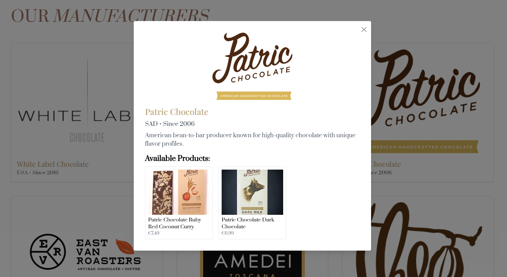
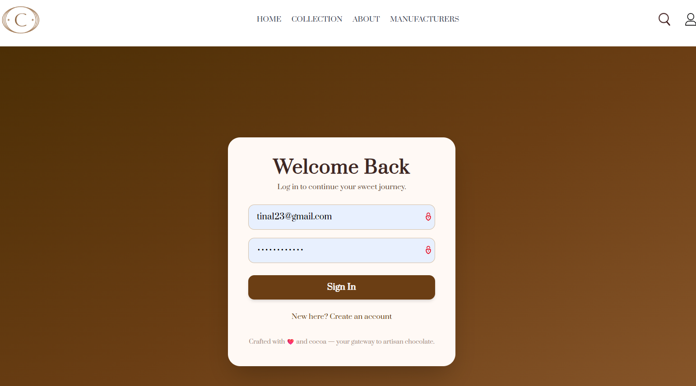
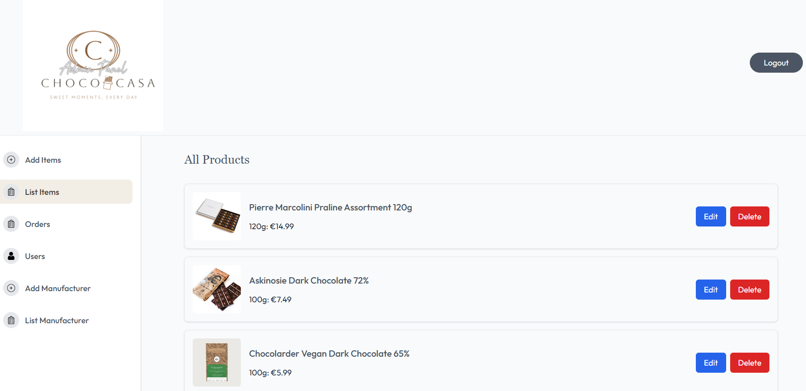
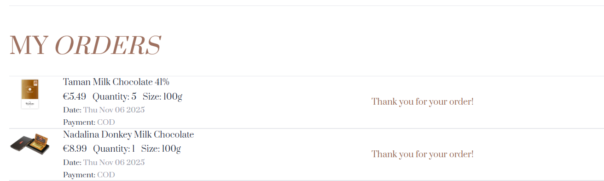

# Choco Shop 🍫

Choco Shop is a full-stack e-commerce web application for browsing chocolate products and managing online shopping orders. The project includes a customer-facing storefront and a backend connected to a database.

## Screenshots

### Home Page


### Product Collection


### Details about manufacturers


### Login


### Admin Panel


### Orders


## Features

- Browse chocolate products and collections
- Search for products
- Add products to the shopping cart
- Review cart items and order totals
- Enter delivery information when placing an order
- User profile and informational pages

## Tech Stack

- **Frontend:** React, Vite, JavaScript, CSS
- **Backend:** Node.js
- **Database:** MongoDB
- **Package management:** npm
- **Version control:** Git and GitHub

## Project Structure

```text
Choco-shop/
├── frontend/
│   ├── src/
│   │   ├── assets/
│   │   │   └── assets.js
│   │   └── pages/
│   └── package.json
├── backend/
│   ├── server.js
│   └── package.json
├── screenshots/
└── README.md
```

## Getting Started

### Prerequisites

- Node.js and npm
- A MongoDB database
- Git

### 1. Clone the repository

```bash
git clone https://github.com/martinavukojevic/Choco_shop.git
cd Choco-shop
```

### 2. Set up the backend

```bash
cd backend
npm install
```

Configure the required environment variables using the backend's existing configuration and your own MongoDB connection string.

Start the backend:

```bash
npm start
```

The backend runs on port `4000` in the current configuration.

### 3. Set up the frontend

Open a second terminal from the project root:

```bash
cd frontend
npm install
npm run dev
```

Open the local URL printed by Vite in your terminal, usually:

http://localhost:5173/

Keep both the backend and frontend terminals running while using the application.

## Environment Variables

The backend requires a valid MongoDB connection configuration. Create a local `.env` file if required by the existing backend setup.

**Do not commit passwords, database credentials, API keys, or other secrets to GitHub.**

## Future Improvements

- Improve input validation and error handling
- Add automated tests
- Improve deployment and production configuration

## Author

Martina Vukojević

GitHub: [martinavukojevic](https://github.com/martinavukojevic)
